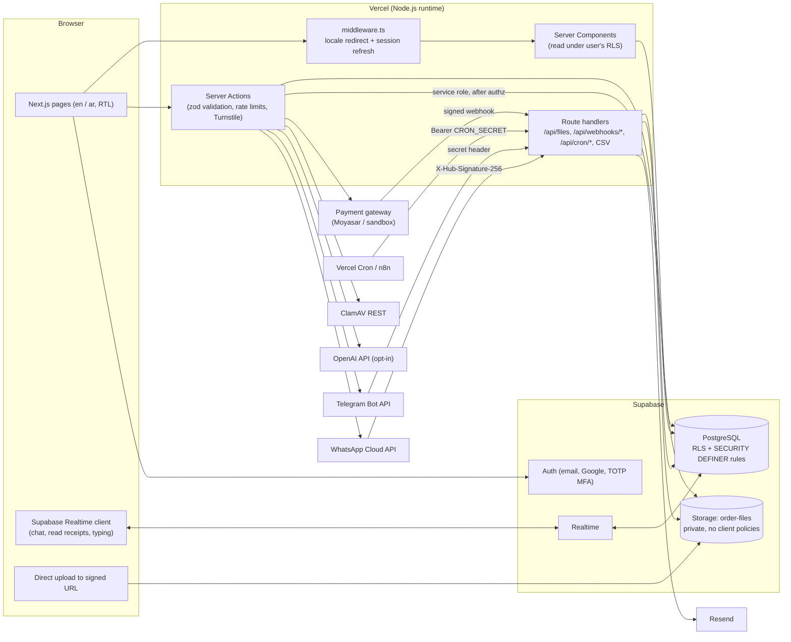

# Architecture, deployment and threat model

## System diagram

## Request paths that matter

**Reads** run in Server Components with the user's own Supabase session, so row-level security decides what comes back. The admin pages use exactly the same client: an admin sees more only because `is_admin()` is true in the policies, and `is_admin()` requires an `aal2` (MFA-verified) JWT.

**Writes** run in Server Actions. Next.js rejects a Server Action whose `Origin` does not match the host, which is the CSRF defence; each action validates its input with zod and, where abuse is plausible, calls the Postgres-backed rate limiter. Business transitions — submitting, quoting, accepting, paying, delivering, revising, refunding — are never plain `UPDATE`s: they are `SECURITY DEFINER` functions that lock the order row, check the actor and the transition, write the immutable history row and enqueue notifications in one transaction. A trigger refuses any status change that does not come through them.

**Files** never touch a storage policy. The server registers a `files` row, hands the browser a single-use signed upload token, and after the upload re-reads the object, checks its magic bytes against the declared type, hashes it, scans it and only then marks it `ready`. Downloads go through `/api/files/[id]`, which reads the row under the caller's RLS (a customer cannot see an undelivered deliverable) and redirects to a 60-second signed URL.

**Payments** are confirmed only by the gateway: the redirect back from checkout shows "waiting for confirmation" and changes nothing. The webhook handler authenticates the request, normalizes the event through the provider's adapter and calls `apply_payment_event`, which is idempotent on `(provider, event_id)`, refuses amount or currency mismatches, ignores stale events and never regresses a paid payment.

**Service role** is used only server-side and only after an authorization decision in code: registering files, writing computed estimates, consuming link codes, processing webhooks, the email outbox and the rate limiter.

## Deployment topology

| Component | Recommended | Notes |
|---|---|---|
| Web app | AWS Amplify (`us-east-2`) or Vercel Pro (`cle1`, Cleveland — same area as `us-east-2`) | All hosting is in the USA by owner decision; Node.js runtime for webhooks (raw body, `node:crypto`) |
| Database, Auth, Storage, Realtime | Supabase Pro in `us-east-2`, or self-hosted Supabase on AWS EC2 in `us-east-2` | Keep the web app in the same region; PITR add-on for backups. Hosting personal data of Saudi residents in the USA is a cross-border transfer under PDPL — see approval item 6 |
| Cron | Vercel Cron: `*/5 * * * *` → `/api/cron/notifications` | or an n8n schedule node |
| Malware scanner | ClamAV REST container on a small VPS or Fly.io machine, reachable only from Vercel egress | |
| n8n (optional) | Self-hosted behind Cloudflare Access, or n8n Cloud | Calls the app's cron endpoints; never holds the service-role key unless a workflow needs DB access |
| DNS, bot protection | Cloudflare (Turnstile, DNS, optional WAF in front of Vercel) | |

Environments: `local` (Supabase CLI), `staging` (separate Supabase project, sandbox gateway keys, `PAYMENTS_SANDBOX_ENABLED=true`), `production` (live keys; the sandbox adapter refuses to load when `NODE_ENV=production`).

## Threat model (STRIDE)

| Threat | Example | Mitigation in this codebase | Residual risk / follow-up |
|---|---|---|---|
| Spoofing — account takeover | Credential stuffing on `/login` | Rate limit per IP+email, Supabase password hashing, shared password policy, optional TOTP | Encourage MFA for customers; monitor auth logs |
| Spoofing — admin | Stolen owner password | `is_admin()` requires `aal2`; every admin read and write is checked in Postgres, not just in the UI | Keep recovery codes offline; second factor on the email account |
| Spoofing — external channel | Someone messages the WhatsApp number claiming to be a customer | Inbound messages attach to a customer only through `channel_identities.verified_at`, set by a one-time code issued inside the authenticated portal; unverified threads show "Unverified sender" and contain no order data | Owner must not disclose order details in unverified threads |
| Spoofing — webhook | Forged "payment paid" POST | Signature/secret verification per adapter; Moyasar adapter re-fetches the payment from the API; amount and currency are compared to the expected payment | Rotate webhook secrets on staff change |
| Tampering — price | Client edits the estimate or the charge | Estimates are recomputed server-side; `estimate_amount` is not a client-writable column; charge amounts come from `create_payment_intent` inside Postgres | — |
| Tampering — status | Customer sets their order to `paid` | No column grant on `status`; trigger blocks updates outside the transition functions; transitions checked per actor | — |
| Tampering — history | Rewriting the audit trail | `order_status_history`, `audit_logs`, `consent_records` are append-only (trigger), with audit triggers on financial tables | A database superuser can still alter them; keep PITR and off-site exports |
| Repudiation | "I never accepted that quote" | Quote acceptance, consents with policy versions, status history with actor ids and timestamps | — |
| Information disclosure — cross-customer | Guessing another order's UUID | RLS on every table; files only via RLS-checked route; internal notes in a separate admin-only table | Run the SQL suite in CI on every migration change |
| Information disclosure — files | Malicious upload or link sharing | Private bucket, 60 s signed URLs, extension + magic-byte checks, ClamAV hook, 25 MB cap, generated storage keys | Office macros are not stripped; scanner must be deployed before launch |
| Information disclosure — AI | Personal data sent to OpenAI | Off by default; requires per-order consent; redaction of emails, phones, IDs, IBANs, cards, URLs; `store: false`; output stored only as an owner-only note | Free text can still identify a person; disclosed in the privacy policy |
| Information disclosure — CSV | Formula injection into the owner's spreadsheet | `csvCell` neutralizes leading `= + - @` | — |
| Denial of service | Upload or message floods | Postgres rate limiter (fails closed), body size limits, Turnstile on public forms | Add Cloudflare WAF rate rules in front of Vercel |
| Elevation of privilege | Customer grants themselves `admin` | `user_roles` has no client write grants; role changes are audited | Admin bootstrap is a manual SQL step (runbook) |
| XSS | Script in a message or article | React escaping; articles rendered as text paragraphs; CSP with `frame-ancestors 'none'`, `object-src 'none'` | `script-src 'unsafe-inline'` is required by Next.js without nonces; move to nonce-based CSP when feasible |
| SQL injection | Filters in admin search | Supabase query builder parameterizes; the one PostgREST `or()` filter strips `, ( ) * % \` from user input | — |
