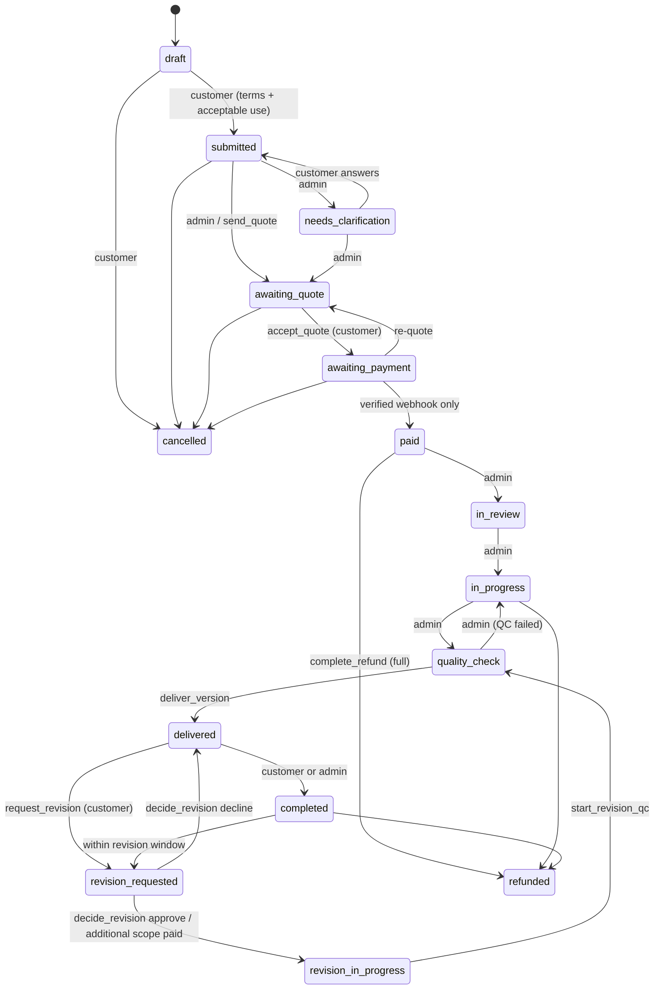

# Data model, workflow and row-level security

Source of truth: `supabase/migrations/` (applied in filename order). Proof that it behaves: `supabase/sql-tests/rls_and_workflow_test.sql`, run with `npm run test:db`.

## Tables

| Table | Purpose | Customer can | Admin (aal2) can |
|---|---|---|---|
| `profiles` | One per auth user; locale, time zone, currency, phone | read/update own (name, locale, tz, currency, phone, marketing) | read all |
| `user_roles` | `customer`, `admin`, future `support_agent`, `contractor` | read own | read all; writes only by SQL/service role |
| `services`, `pricing_rules`, `discounts`, `exchange_rates` | Catalogue and pricing configuration | read active services/rules | full CRUD |
| `orders` | Intake fields, estimate, consents, lifecycle timestamps | insert drafts; edit intake fields while `draft`; delete drafts | read all; status via functions only |
| `order_requirements` | Owner's clarification questions and answers | read; answer open ones | ask, close |
| `order_status_history` | Immutable timeline (actor, from, to, note) | read own | read all |
| `order_assignments` | Future contractor assignment | — | read |
| `files` | Registered uploads with scan status and SHA-256 | read own ready files; deliverables only once delivered | read all |
| `deliverable_versions` | Numbered deliveries, linked to revisions | read delivered versions | read all; create via `deliver_version` |
| `revisions` | Structured revision requests | read; create via `request_revision` | decide via `decide_revision` |
| `quotes` | Draft → sent → accepted/declined/expired/superseded | read non-draft; accept/decline via functions | create/edit drafts; send via `send_quote` |
| `invoices` | One per accepted quote; total, deposit, paid, refunded | read own | read all |
| `payments` | Ledger rows per checkout attempt; original/payment/settlement currency, rate, fees, references | read own | read all |
| `payment_events` | Raw verified gateway events, unique per provider event id | — | read |
| `refunds` | Requested → approved → processing → succeeded/failed | read own | request, approve |
| `conversations`, `messages`, `conversation_reads` | Order chat and external channel threads, read state | read/post in own | read/post in all |
| `order_internal_notes` | Owner-only notes, including AI drafts | — | full |
| `support_tickets` | Contact-form submissions | read own | read, close |
| `channel_identities`, `channel_link_codes` | Verified Telegram/WhatsApp identities and one-time link codes | read/unlink own | read |
| `notifications` | In-app notifications and the email outbox state | read, mark read | — |
| `consent_records` | Append-only consents with policy versions | insert/read own | read |
| `integration_events` | Inbound/outbound external messages with retry state | — | read |
| `audit_logs` | Append-only row changes on financial and configuration tables | — | read |
| `posts` | Bilingual resources | read published | full |
| `app_config` | Runtime switches (MFA requirement, revision window, AI, express, crypto) | — | read/update |
| `rate_limits` | Fixed-window counters | — | — |

Money is `numeric(12,2)` throughout, in the invoice currency (SAR or USD). Payment and settlement amounts keep their own currency columns so a gateway that charges in one currency and settles in another is recorded faithfully. Card numbers and crypto keys are never stored: gateways return only references.

## Order state machine

The allowed customer and admin edges live in `order_transition_allowed`; `src/lib/orders/status.ts` mirrors them for the UI, and `status.test.ts` parses the SQL to fail if the two drift apart.

## Integrity guarantees and where they are tested

| Guarantee | Mechanism | Test (SQL suite label) |
|---|---|---|
| A customer never sees another customer's data | RLS on every table, `owns_order()` | "other customers see no orders", "… read no messages" |
| Admin access needs MFA | `is_admin()` checks `aal2` | "admin without MFA sees no customer orders" |
| Status only changes through the rules | Column grants + `orders_guard_update` trigger | "status is not a writable column" |
| History is immutable | `prevent_mutation` triggers | "status history is append-only" |
| Price is computed server-side | No grant on estimate columns; `create_payment_intent` | "deposit amount comes from the invoice" |
| Duplicate webhooks have no effect | Unique `(provider, event_id)` | "duplicate webhook is absorbed" |
| Out-of-order webhooks cannot undo a payment | Final-state and `last_event_at` checks | "late failure cannot undo a payment" |
| Under/overpayment is not credited | Amount + currency comparison | "underpayment is not credited" |
| Refunds cannot exceed the payment, need approval | `request_refund` / `decide_refund` / `complete_refund` | "refund cannot exceed the payment", "unapproved refunds cannot complete" |
| Infected files cannot be delivered | `deliver_version` scan check | "infected files cannot be delivered" |
| Revision allowance is enforced | `request_revision` counts included revisions | "revision beyond the allowance is additional scope" |

## Adding a table later

Supabase's default privileges grant new tables to `anon` and `authenticated`. Every new migration must `enable row level security`, add its policies, and grant only the columns a client should write — then add isolation cases to the SQL suite.
