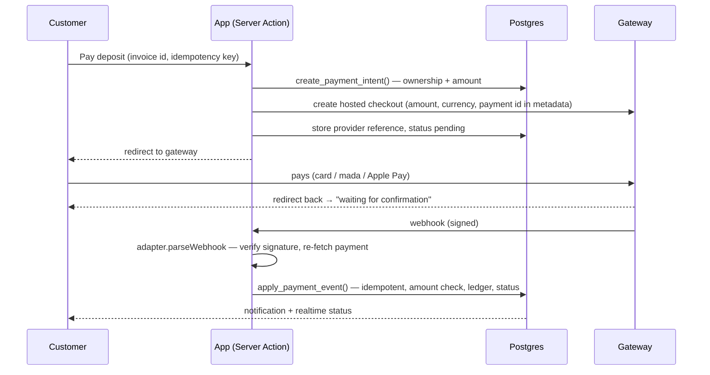

# Payments

## Rules that hold regardless of provider

- Online payments only. There is no bank-transfer, wire, SWIFT, cash-deposit or "upload your receipt" path anywhere in the code, the database or the UI, and the policies say so.
- The customer's browser never decides that anything is paid. Returning from checkout shows "waiting for confirmation"; only a verified gateway event applied by `apply_payment_event` moves money in the ledger. Screenshots and customer-typed transaction IDs are not accepted as evidence.
- The amount to charge is computed in Postgres (`create_payment_intent`) from the invoice: the deposit when nothing is paid yet and a deposit was quoted, otherwise the outstanding balance.
- No card numbers, CVVs or crypto private keys are stored. Checkout is hosted by the gateway; the app stores references only.

## Flow

`apply_payment_event` outcomes: `applied`, `duplicate` (same provider event id), `amount_mismatch` (not credited, owner notified), `already_paid`, `ignored_final` (late failure after success), `stale` (older than the last event), `reference_mismatch`, `unknown_payment`, `status_<x>` for non-final states. Any database error returns HTTP 500 so the gateway retries; retries are harmless because of the unique event id.

## Adapter contract

`src/lib/payments/types.ts` defines `PaymentAdapter`: `createCheckout`, `parseWebhook` (throws `SignatureError`; returns `null` for irrelevant events), `refund`, `isConfigured`, plus `verified`. `availableAdapters()` hides unverified adapters in production even when their keys are present. To add a gateway: implement the interface in `src/lib/payments/adapters/<id>.ts`, register it in `registry.ts`, add its env vars, and point its webhook at `/api/webhooks/payments/<id>`.

| Adapter | Methods | State |
|---|---|---|
| `sandbox` | simulated card / mada / Apple Pay | Working; development and staging only; refuses to load in production |
| `moyasar` | cards, mada, Apple Pay, STC Pay | Written from public API docs; **unverified** |
| HyperPay, Tap, PayTabs | — | Not implemented |
| PayPal | — | Not implemented; merchant eligibility unconfirmed |
| BTC (BTCPay Server / licensed processor), Lightning, ETH/USDT/USDC | — | Not implemented; disabled by policy until legal sign-off (`app_config.crypto_payments_enabled = false`) |

## Sandbox verification checklist (required before setting `verified: true`)

Run against the provider's test environment with test cards, on staging:

1. Successful full payment → order `paid`, invoice `paid`, fees and method recorded.
2. Deposit, then balance → `partially_paid` then `paid`; deliverable download unlocks only after the balance.
3. Declined card → payment `failed`, order unchanged, customer can retry with a new attempt.
4. Same webhook delivered twice → second returns `duplicate`.
5. Failure event delivered after success → `ignored_final`.
6. Webhook with a wrong secret or tampered body → HTTP 401, nothing recorded.
7. Amount tampering (edit the amount at the provider dashboard if possible, or replay a smaller payment's event) → `amount_mismatch`.
8. Abandoned checkout → payment stays `pending`/`initiated`; a new attempt cancels the stale `initiated` row.
9. Partial refund and full refund from the admin → `refunds.succeeded`, invoice `partially_refunded`/`refunded`, order `refunded` only on full refund.
10. mada and Apple Pay specifically (domain verification for Apple Pay is configured at the gateway).
11. Reconciliation: export the gateway's settlement report for the test period and match every `payments.provider_charge_id`.

## Multi-currency

Prices and invoices are in SAR or USD with explicit per-currency prices on services and rules (no runtime conversion). `exchange_rates` exists for display of other currencies only. `payments` stores the expected amount and currency, the amount and currency the gateway reported, and settlement amount/currency and processor fee when the gateway provides them.

## Cryptocurrency (Phase 4, conditional)

Do not enable until a written legal opinion confirms that a Saudi-registered merchant may accept the asset, a licensed processor has onboarded the business, and tax, accounting, custody and AML/KYC procedures are in place. Displaying an indicative crypto price is not the same as accepting crypto and is also off. When approved, implement a BTCPay Server (or processor) adapter that: creates a time-limited invoice with QR code; waits for the configured confirmations before reporting `paid`; reports under- and over-payments as `amount_mismatch` for owner handling; reports expired quotes as `expired`; stores the exchange rate locked at quote time; and is tested on testnet against the checklist above.
